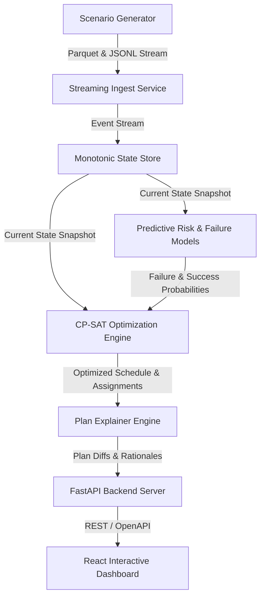

# Adaptive Air Operations Planner (AAOP) - Dynamic Decision-Support Simulator

> [!IMPORTANT]
> **DISCLAIMER:** This project is a synthetic, fictional simulation and decision-support research project. It does **NOT** use real-world operational data, real-world targeting information, real-world tactical procedures, or real-world military recommendations.

---

## System Architecture



---

## Complete Capabilities & Pipeline

1. **Shared Causal Engine (`generator/causal.py`)**: Unified mathematical ground truth for resource failure rates, environmental hazards, and task success probabilities across training, simulation, and inference.
2. **Streaming Event Ingestion (`ingest/`)**: Replays synthetic operational event streams at high throughput with schema validation and consumer lag monitoring.
3. **Monotonic Versioned State Store (`state/`)**: State mutation tracking with exact snapshot reconstruction at any event version $N$.
4. **CP-SAT & ML Hybrid Solver (`optimize/`)**: Multi-objective OR-Tools CP-SAT formulation incorporating LightGBM/XGBoost failure & success predictions with penalty-based plan stability tuning.
5. **Plan Explanation Engine (`optimize/explain.py`)**: Automated natural language rationales, resource churn tracking, and binding constraint explanations.
6. **What-If Scenario Evaluation Engine (`eval/whatif_engine.py`)**: Zero-side-effect evaluation of hypothetical state branches and operational disruptions.
7. **FastAPI & React Technical Dashboard (`api/`, `ui/`)**: Production-ready API backend and live dashboard featuring Leaflet geospatial maps, Gantt timelines, ML model risk scores, and What-If comparison tools.
8. **Monte Carlo & Performance Profiling (`eval/`)**: Benchmarked 30-seed simulation suite and end-to-end latency profiling ($P_{50} = 49.08\text{ ms}$, $P_{95} = 98.42\text{ ms}$).

---

## Docker Deployment (Phase 17)

Run the full system stack (Backend, Frontend SPA, Redpanda, Redis, PostgreSQL) with a single command:

```bash
docker compose up --build
```

- **Frontend Dashboard**: `http://localhost`
- **FastAPI API Documentation**: `http://localhost:8000/docs`
- **Healthcheck**: `http://localhost:8000/health`

---

## Local Development & Testing

### Run Python Test Suite (58 Unit & Integration Tests)
```bash
python -m pytest
```

### Run Frontend Dashboard Locally
```bash
cd ui
npm install
npm run dev
```

### Execute Scenario Generation
```bash
python -m generator.cli --config configs/medium.yaml --output data/scenarios/run_demo
```

---

## License

MIT License. See [LICENSE](LICENSE) for details.
